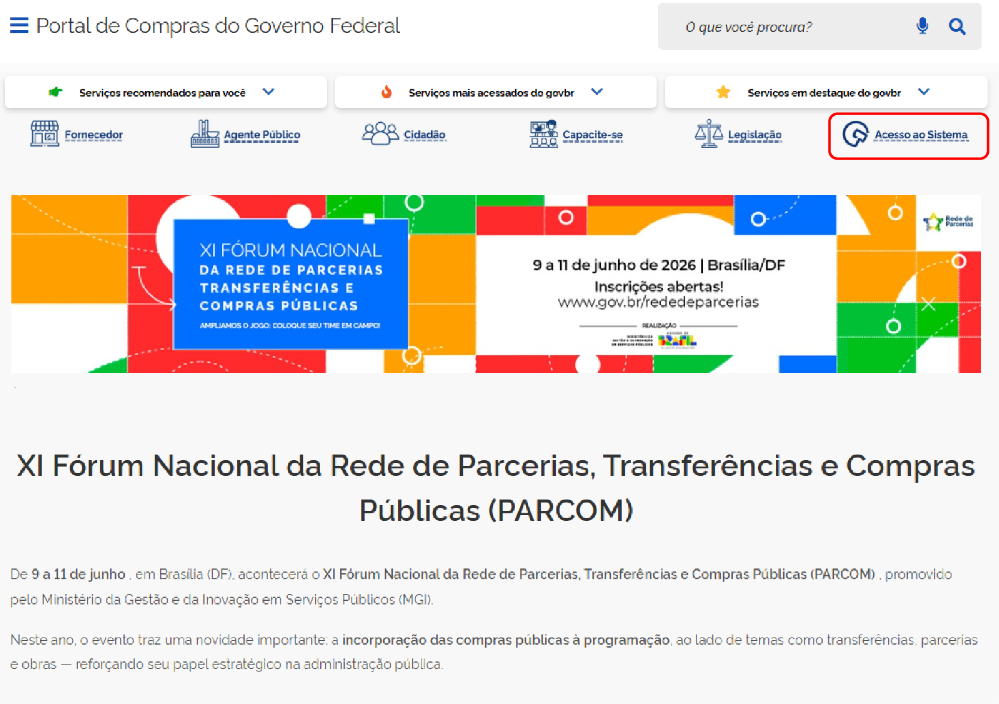

  Tamanho do texto:
  <button onclick="diminuirFonte()" title="Diminuir texto" style="padding: 6px 12px; font-weight: bold; cursor: pointer; border: 1px solid #ccc; border-radius: 4px; background: #f8f9fa;">A-</button>
  <button onclick="resetarFonte()" title="Tamanho normal" style="padding: 6px 12px; font-weight: bold; cursor: pointer; border: 1px solid #ccc; border-radius: 4px; background: #f8f9fa;">A</button>
  <button onclick="aumentarFonte()" title="Aumentar texto" style="padding: 6px 12px; font-weight: bold; cursor: pointer; border: 1px solid #ccc; border-radius: 4px; background: #f8f9fa;">A+</button>
  
  <button onclick="window.print()" style="background-color: #0056b3; color: white; padding: 6px 16px; border: none; border-radius: 5px; font-size: 14px; cursor: pointer; box-shadow: 0 2px 4px rgba(0,0,0,0.2); margin-left: 10px;">
    🖨️ Imprimir ou baixar esta página
  </button>

PÚBLICO-ALVO: AGENTE DE CONTRATAÇÃO

# ACESSANDO O MÓDULO NOVO DIVULGAÇÃO DE COMPRAS

Está disponível, no Novo Divulgação de Compras (Novo DC), a funcionalidade “Eventos de Suspensão, Revogação e Anulação” para contratações diretas, licitações presenciais e credenciamentos[cite: 1].

!!! note "Nota"
    As alterações são automaticamente refletidas no Portal Nacional de Contratações Públicas (PNCP), por isso não há a necessidade de revogar o resultado já divulgado no PNCP e publicar uma nova contratação[cite: 1].

!!! warning "Atenção"
    Não é possível criar um Evento de Alteração em contratações com empenho ou contrato vigente. Nesses casos, antes de incluir o Evento de Alteração, será preciso desfazer todas as operações no sistema Contratos.gov.br[cite: 1].

**Passo 1:** Acesse o Portal de Compras do Governo Federal e clique em “Acesso ao Sistema”.

**Passo 2:** Escolha o perfil “Governo” e faça o login com o gov.br.

**Passo 3:** Acesse o módulo “Novo Divulgação de Compras”.

 

  <button onclick="window.print()" style="background-color: #0056b3; color: white; padding: 10px 20px; border: none; border-radius: 5px; font-size: 16px; cursor: pointer; box-shadow: 0 2px 4px rgba(0,0,0,0.2);">
    🖨️ Imprimir ou baixar esta página
  </button>

