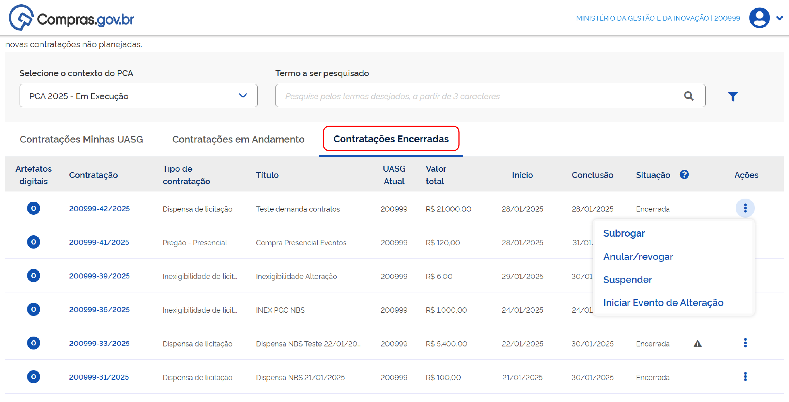
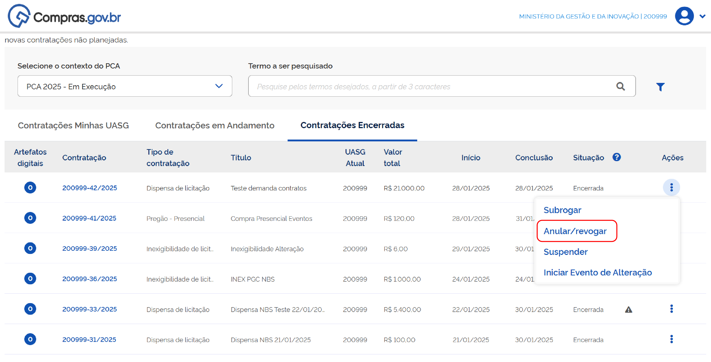
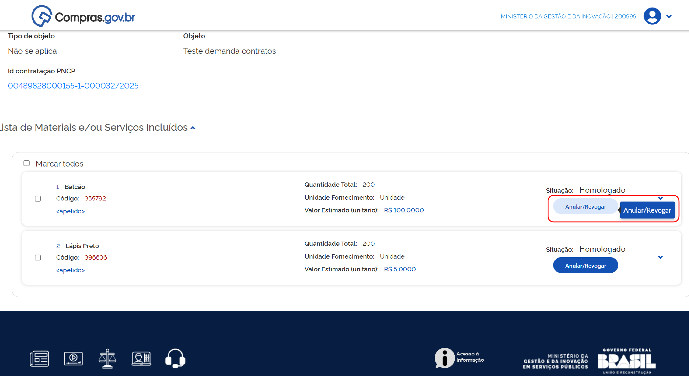
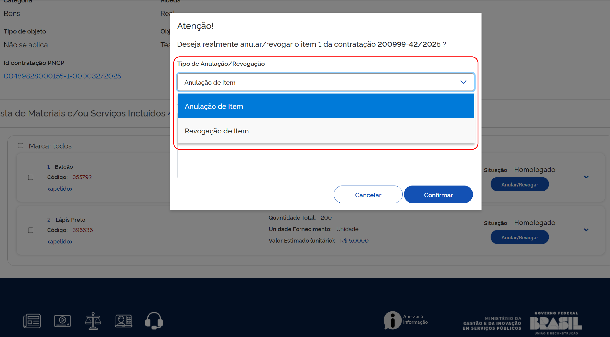
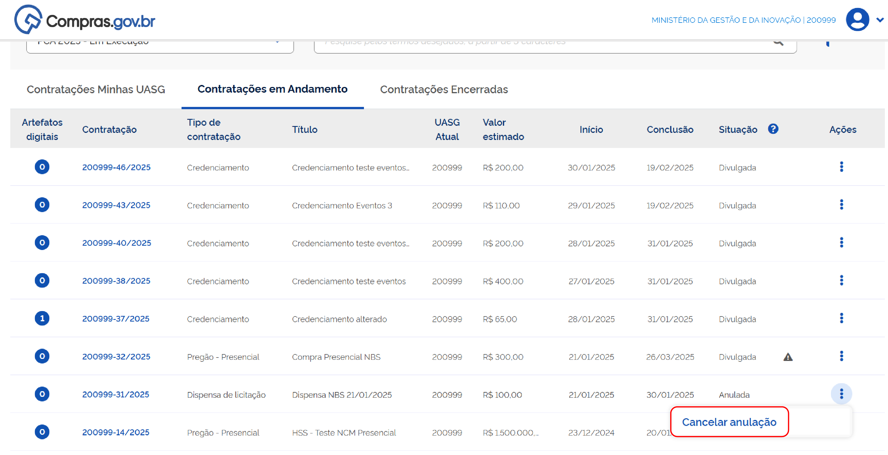
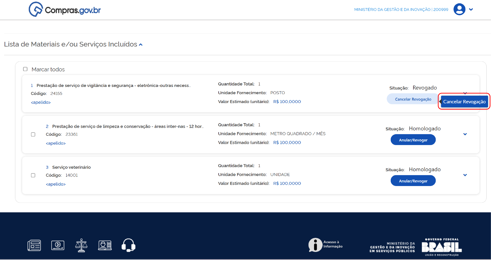

  Tamanho do texto:
  <button onclick="diminuirFonte()" title="Diminuir texto" style="padding: 6px 12px; font-weight: bold; cursor: pointer; border: 1px solid #ccc; border-radius: 4px; background: #f8f9fa;">A-</button>
  <button onclick="resetarFonte()" title="Tamanho normal" style="padding: 6px 12px; font-weight: bold; cursor: pointer; border: 1px solid #ccc; border-radius: 4px; background: #f8f9fa;">A</button>
  <button onclick="aumentarFonte()" title="Aumentar texto" style="padding: 6px 12px; font-weight: bold; cursor: pointer; border: 1px solid #ccc; border-radius: 4px; background: #f8f9fa;">A+</button>
  
  <button onclick="window.print()" style="background-color: #0056b3; color: white; padding: 6px 16px; border: none; border-radius: 5px; font-size: 14px; cursor: pointer; box-shadow: 0 2px 4px rgba(0,0,0,0.2); margin-left: 10px;">
    🖨️ Imprimir ou baixar esta página
  </button>

PÚBLICO-ALVO: AGENTE DE CONTRATAÇÃO

# ANULAÇÃO E REVOGAÇÃO

Esse tipo de evento pode ser realizado em:

* Contratações diretas sem disputa e licitações presenciais - a partir da aba “Contratações encerradas”, do Novo DC[cite: 1]; e
* Credenciamentos; licitações eletrônicas e dispensas eletrônicas, a partir da aba "Contratações em andamento" do Novo DC[cite: 1].

Após a abertura da sessão pública, a anulação ou revogação de itens de licitações eletrônicas devem ser feitas na sala de disputa[cite: 1].

!!! warning "Atenção"
    Eventos de anulação podem ser necessários quando houver alguma ilegalidade processual. Eventos de revogação podem ser feitos por necessidade ou conveniência da administração pública[cite: 1].

**Passo 4:** Clique na aba “Contratações Encerradas”[cite: 1].

**Passo 5:** Clique nos três pontos e selecione “Anular/Revogar”[cite: 1].

O sistema mostrará a página de resumo da contratação[cite: 1].

**Passo 6:** Role a tela e localize os itens que deseja alterar[cite: 1].

**Passo 7:** Clique no botão “Anular/Revogar”[cite: 1].

O sistema abrirá uma tela para registro do tipo de anulação/revogação para inclusão da justificativa da ação[cite: 1].

**Passo 8:** Selecione a ação a ser realizada, escreva a justificativa e confirme[cite: 1].

O sistema confirmará finalização com sucesso[cite: 1].

!!! warning "Atenção"
    Caso haja qualquer impedimento no sistema Contratos.gov.br (empenho ou contrato ativo relacionado ao item), o sistema emitirá alerta da existência deste impedimento e não registrará a ação[cite: 1].

---

## Cancelamento de Anulação ou Revogação

É possível cancelar o evento de anulação ou revogação[cite: 1].

Para cancelar anulação ou revogação de item, na contratação desejada localizada em Contratações Encerradas na página inicial do Novo DC, clique nos três pontos e selecione “Anular/revogar”[cite: 1].

También é possível cancelar o evento de anulação ou revogação a partir da aba Contratações em Andamento da tela inicial do Novo DC. No entanto, essa opção aparece somente quando todos os itens da contratação estiverem anulados e/ou revogados[cite: 1].

**Passo 9:** Para cancelar um evento de anulação clique nos 3 pontos e em seguida em “Cancelar anulação”[cite: 1].

O sistema retornará na página de resumo da contratação[cite: 1].

**Passo 10:** Role a tela pra baixo e localize os itens que deseja alterar[cite: 1].

**Passo 11:** Clique em “Cancelar Revogação”[cite: 1].

O sistema abrirá uma tela para registro da justificativa da ação. Preencha e confirme a ação[cite: 1]. 

O sistema confirmará a finalização com sucesso[cite: 1].

 

  <button onclick="window.print()" style="background-color: #0056b3; color: white; padding: 10px 20px; border: none; border-radius: 5px; font-size: 16px; cursor: pointer; box-shadow: 0 2px 4px rgba(0,0,0,0.2);">
    🖨️ Imprimir ou baixar esta página
  </button>

