

  Tamanho do texto:
  <button onclick="diminuirFonte()" title="Diminuir texto" style="padding: 6px 12px; font-weight: bold; cursor: pointer; border: 1px solid #ccc; border-radius: 4px; background: #f8f9fa;">A-</button>
  <button onclick="resetarFonte()" title="Tamanho normal" style="padding: 6px 12px; font-weight: bold; cursor: pointer; border: 1px solid #ccc; border-radius: 4px; background: #f8f9fa;">A</button>
  <button onclick="aumentarFonte()" title="Aumentar texto" style="padding: 6px 12px; font-weight: bold; cursor: pointer; border: 1px solid #ccc; border-radius: 4px; background: #f8f9fa;">A+</button>
  
  <button onclick="window.print()" style="background-color: #0056b3; color: white; padding: 6px 16px; border: none; border-radius: 5px; font-size: 14px; cursor: pointer; box-shadow: 0 2px 4px rgba(0,0,0,0.2); margin-left: 10px;">
    🖨️ Imprimir ou baixar esta página
  </button>

PÚBLICO-ALVO: AGENTE DE CONTRATAÇÃO

# EVENTO DE ALTERAÇÃO

Eventos de alteração podem ser realizados nos seguintes momentos[cite: 1]:

* Contratações diretas sem disputa – a qualquer momento[cite: 1];
* Licitações presenciais – a qualquer momento[cite: 1];
* Credenciamento – antes da divulgação de resultados[cite: 1];
* Licitações eletrônicas e dispensa eletrônica – antes da abertura da disputa[cite: 1].

**O que pode ser alterado neste tipo de evento:**  
As alterações dependem do tipo de contratação. Os campos passíveis de alteração ficarão habilitados no Compras.gov.br e os campos que não podem ser alterados ficarão inacessíveis ao usuário[cite: 1].

**Passo 01:** Acesse o Portal de Compras do Governo Federal e clique em “Acesso ao Sistema”[cite: 1].

**Passo 02:** Escolha o perfil “Governo” e faça o login com o gov.br[cite: 1].

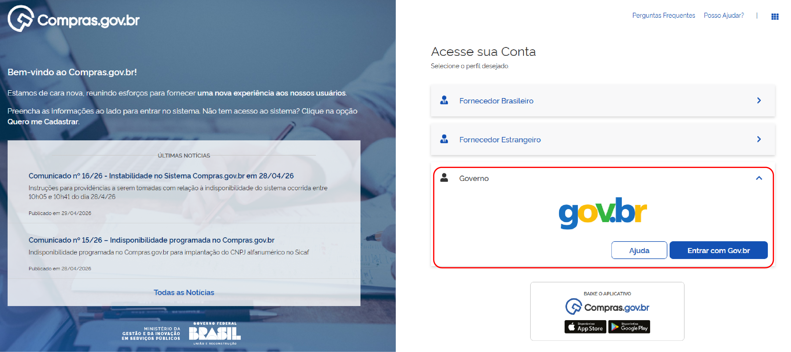

**Passo 03:** Acesse o módulo “Novo DC”[cite: 1].

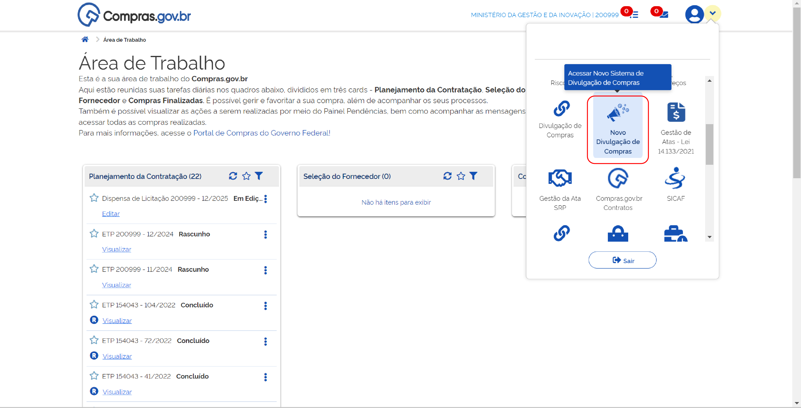

**Passo 04:** Localize a contratação que deseja alterar. Clique nos três pontos e selecione “Iniciar Evento de Alteração”[cite: 1].

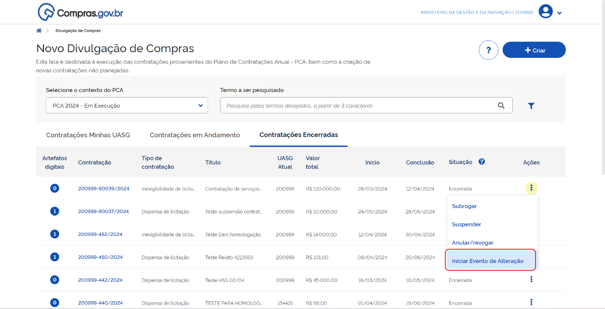

**Passo 05:** Confirme o início do evento de alteração[cite: 1].

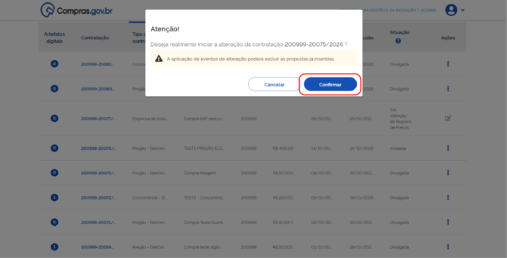

O sistema confirmará que seu evento foi iniciado[cite: 1].

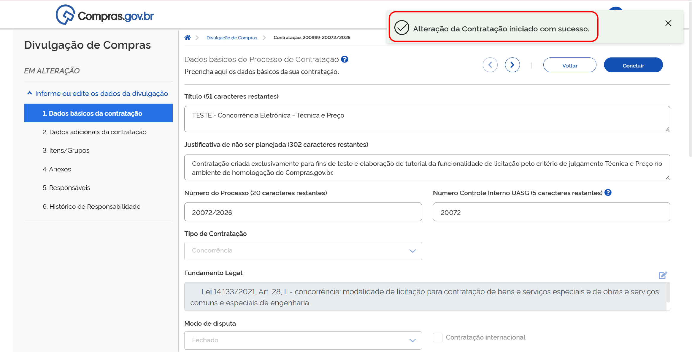

!!! warning "Atenção"
    Para licitações eletrônicas e dispensas eletrônicas, a aplicação de eventos de alteração poderá excluir as propostas já inseridas, em conformidade com a Lei nº 14.133/2021[cite: 1].

**Passo 06:** Na aba “Dados Básicos da Contratação”, apenas os campos realçados em preto podem ser alterados[cite: 1].

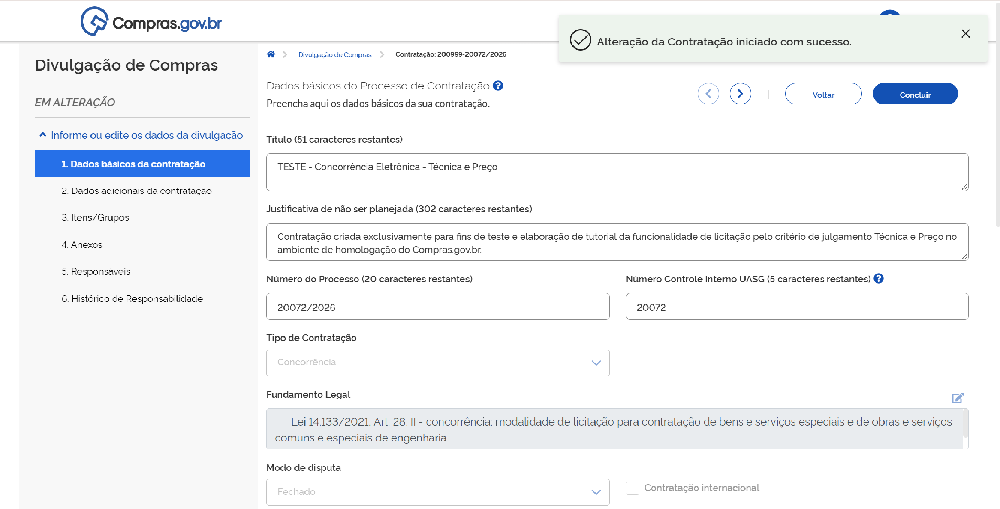

!!! note "Nota"
    É obrigatório o preenchimento do campo “Justificativa de Evento de Alteração” (circular)[cite: 1].

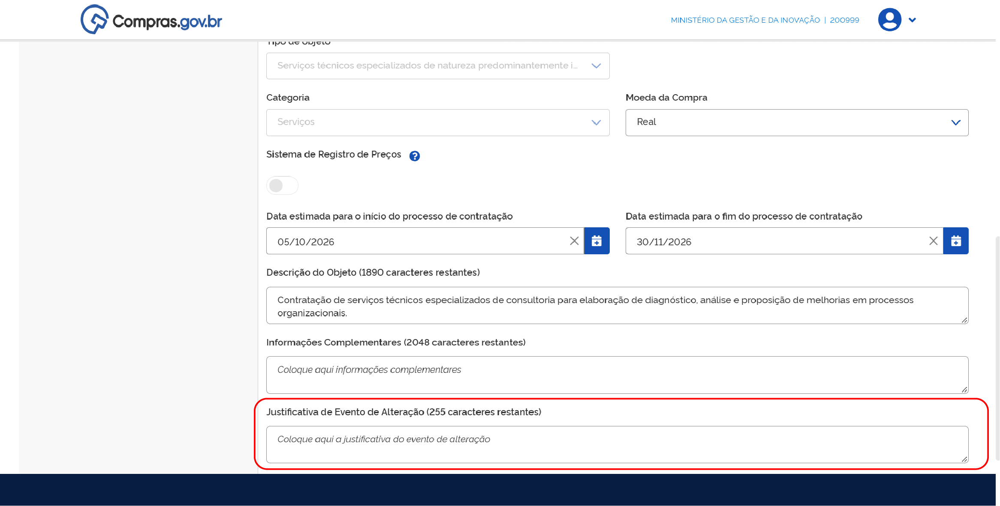

**Passo 07:** Na aba “Dados adicionais da Contratação”, você poderá alterar todos os campos habilitados. Caso não haja modificação em prazos, é necessário o preenchimento do campo de justificativa[cite: 1].

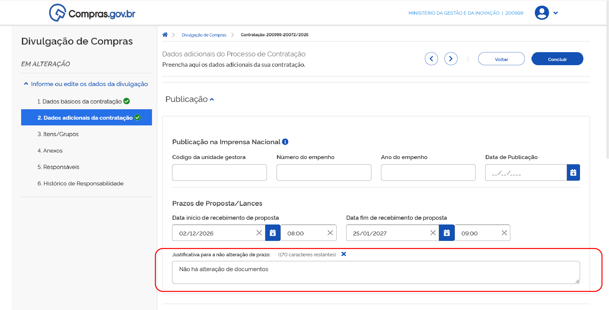

**Passo 08:** Na aba “Itens/Grupos” podem ser alterados todos os campos habilitados, conforme o tipo de contratação. Poderão ser adicionados e/ou excluídos itens, formados ou desfeitos grupos[cite: 1].

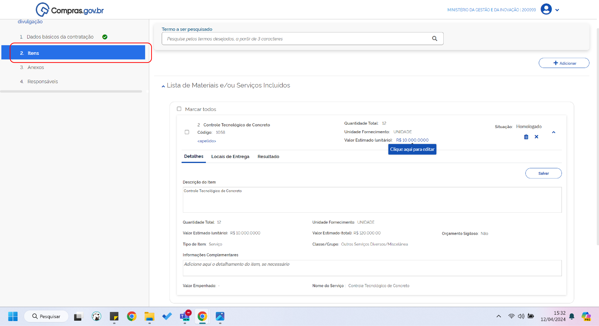

**Passo 09:** Na aba “Anexos”, podem ser removidos ou incluídos anexos em formato digital ou artefatos vinculados[cite: 1].

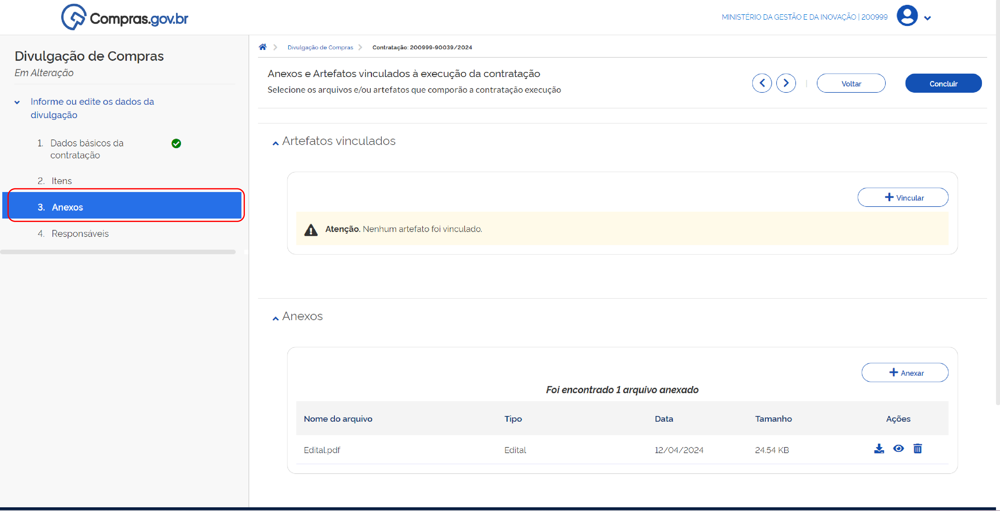

**Passo 10:** Na aba “Responsáveis”, podem ser adicionados ou excluídos responsáveis pela contratação[cite: 1].

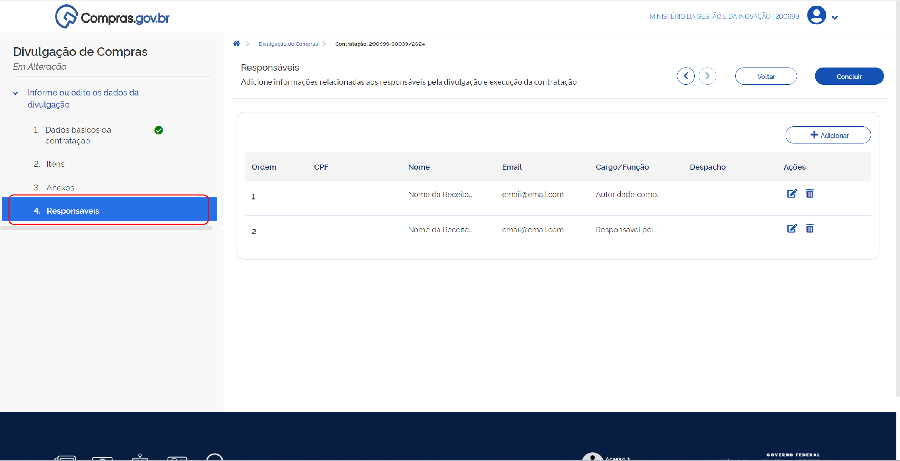

**Passo 11:** Para finalizar o evento de alteração, clique em “Concluir”[cite: 1].

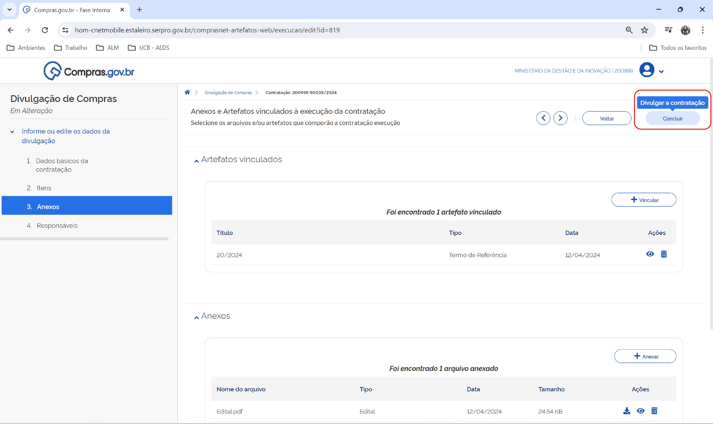

**Passo 12:** Para divulgar seu evento de alteração, clique em “Divulgar a contratação”[cite: 1].

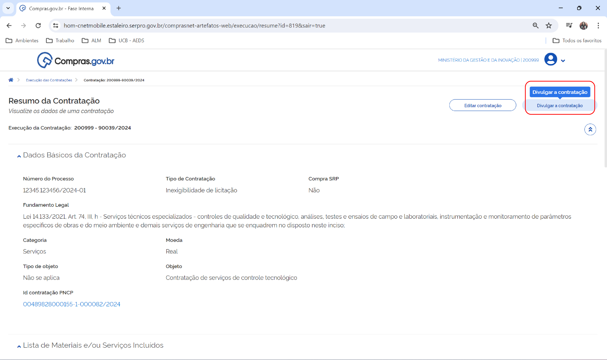

A próxima tela mostrará o ID da contratação no PNCP. Não se preocupe, ele permanece o mesmo da contratação original[cite: 1].

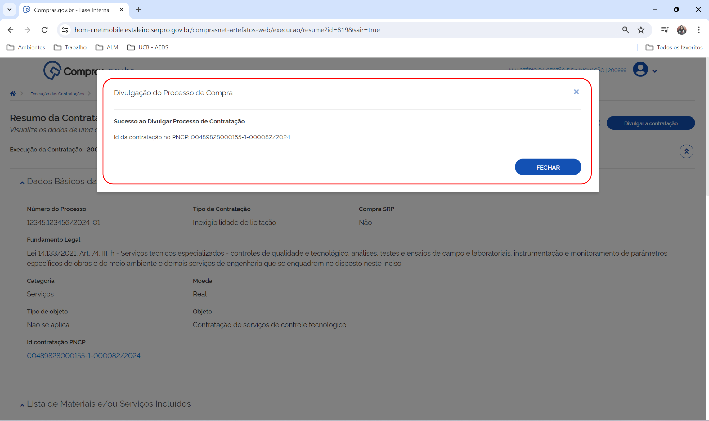

Pronto! O evento de alteração da contratação foi realizado[cite: 1].

No PNCP, seus eventos de alteração ficarão registrados no histórico do processo com a data e a hora em que o evento foi publicado[cite: 1].

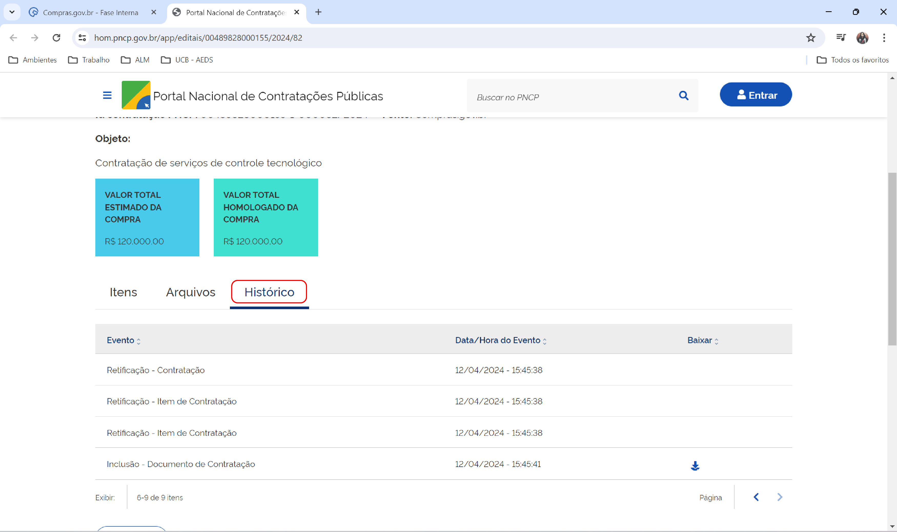

---

## Cancelamento de Evento de Alteração

!!! warning "Atenção"
    Caso não seja mais necessária a complementação ou a correção das informações da contratação direta divulgada, é possível cancelar o Evento de Alteração antes de sua publicação no PNCP[cite: 1].

Para interromper a inclusão do evento de alteração antes de sua publicação no PNCP e recuperar a versão anterior da sua contratação, na aba “Contratações da Minha UASG” clique no ícone “Cancelar evento de alteração”. Esse botão permite que sua versão divulgada seja restaurada. Todas as alterações NÃO publicadas serão perdidas[cite: 1].

!!! note "Nota"
    Só é possível o cancelamento nos casos em que o evento de alteração não tenha sido publicado no PNCP[cite: 1].

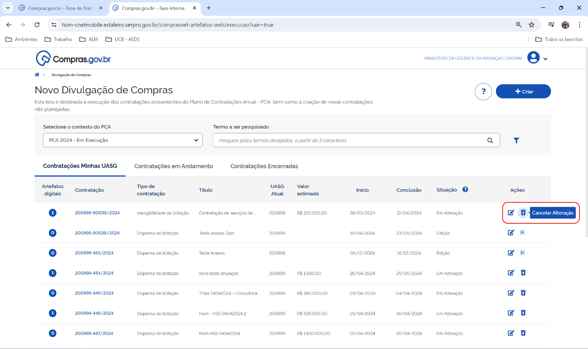

Confirme o cancelamento do evento de alteração[cite: 1].

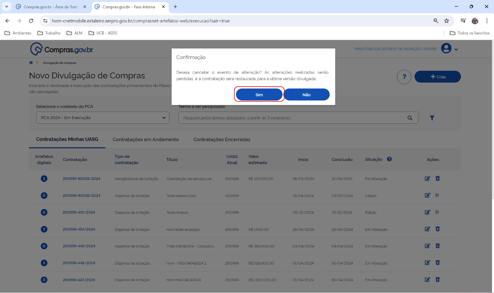

Pronto! Seu evento de alteração foi cancelado[cite: 1].

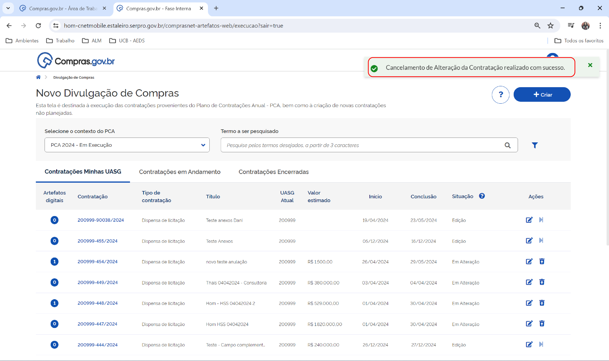

 

  <button onclick="window.print()" style="background-color: #0056b3; color: white; padding: 10px 20px; border: none; border-radius: 5px; font-size: 16px; cursor: pointer; box-shadow: 0 2px 4px rgba(0,0,0,0.2);">
    🖨️ Imprimir ou baixar esta página
  </button>

